# 东方航空智能营销平台技术方案与数据来源

文档版本 V2.0，日期 2026年10月13日。Word沿用总决赛原模板；本文为正文与图表的可审阅文本。

## 项目概况
### 背景和基础
东方航空智能营销平台面向航空旅客数字画像与节假日营销，将分散的客户需求、航班供给、产品权益、渠道授权和营销反馈连接为可执行、可追溯的业务流程。平台以东东营销助手为自然语言入口，以航空营销本体为统一语义与资格约束层，以 AgentScope 2.0.8 为受控智能体运行框架，以 A2UI 声明式组件呈现后台计算结果。当前成果为可运行的竞赛演示系统，使用用户提供的航班爬取资料与显式标识的模拟业务数据，已完成本地入库、业务工作台映射和本体实例投影。
项目要解决的技术问题是：当运营人员提出“为国庆上海至三亚的家庭客群策划活动”时，系统不仅要生成文字，还应验证客群是否允许触达、航班是否存在、票价是否有产品依据、权益是否覆盖机场与日期、预算是否足够，并在保存活动时保留所用数据版本和证据。如果缺少供给关系或上游可售状态，系统应明确阻断或保留待核验，而非由大模型补全未知事实。
原有项目需求材料《航空旅客数字画像和 AIGC 智慧营销》提供行业应用背景，来源于另一竞赛的企业命题资料。本次成果按第八届中国研究生人工智能创新大赛总决赛模板组织，前述材料仅作为场景来源，不将其主办单位、组别或企业合作状态移植为本次报名信息。团队、组别、队员与指导教师信息在封面及分工表中预留。
已有工作包括原生 JavaScript 生产前端、FastAPI 业务 API、SQLAlchemy 数据层、多租户权限、知识与本体工作台、六个营销智能域、东东会话与任务持久化、模型提供商配置、营销活动版本与审批执行流程。2026 年 10 月 12 日完成 CE26 数据版本入库，随后完成节假日营销七阶段分析与本体关系对照。本文技术事实以系统 v3.19、代码提交 124d2bdd3828 和 2026 年 10 月 13 日的本地验证状态为基线。

表 1  项目成果与实现状态

| 能力 | 当前实现 | 适用边界 |
| --- | --- | --- |
| 数据与画像 | 29 个已导入数据集，429,996 条源记录；10,000 名模拟客户 | 源记录数含原始层和派生层，不能当作旅客数 |
| 航空营销本体 | 类型、关系端点、业务投影、局部图谱查询与证据定位 | 关系路径与显式规则驱动，未部署通用 OWL 自动推理器 |
| 智能体协作 | 六个业务智能域及东东、数据处理角色，共用 AgentScope 运行适配层 | 领域角色按任务调用，节假日链路由确定性后台函数串联 |
| 对话交互 | 流式公开过程、A2UI 图表表格与图谱、会话历史、待确认任务、显式记忆 | 公开步骤与工具结果可见，不暴露模型隐藏思维内容 |
| 业务闭环 | 候选方案、草稿保存、客群快照、内容版本及本体投影 | 本轮未接入真实营销渠道和真实可售库存 |
| 算法模型 | 已准备时点化购买倾向、实验及库存样本 | 本文给出训练方案，尚未训练或上线预测模型 |

### 场景和价值
平台覆盖机会洞察、客群圈选、产品匹配、内容生成、活动编排、审批、执行监控和效果复盘。核心演示采用 2026 年国庆上海浦东至三亚家庭出游场景，业务观测截止为 2026 年 9 月 30 日 23:59:59，出行窗口为 10 月 1 日至 7 日。由于该窗口在文档形成时已经结束，本场景属于历史模拟回放，不能作为当前可直接投放的活动。
航空营销的难点在于跨对象联合决策。例如，家庭标签只能说明画像倾向，不能证明本次同行人数；机上 Wi-Fi 权益依赖具体航班支持状态；接送服务依赖目的机场范围；票价产品有独立版本和有效期；App 授权不能代替短信授权。平台将上述条件作为显式后台校验，并通过本体连接相应对象，避免把“相关性较高”误当成“业务上可执行”。
平台的潜在价值是减少人工查表、跨系统核对和方案回填成本，使营销策略、产品事实、渠道权限和结果口径在同一工作空间中保持一致。当前未开展企业生产 A/B 试验，也未取得可核验的收入、客座率或成本收益增幅。因此本文不以推测的转化提升或 ROI 证明价值，而以可复现的数据、关系门禁、闭环记录和测试证据证明技术可行性。

表 2  应用场景与可验证输出

| 场景 | 需要联合的数据 | 平台输出 |
| --- | --- | --- |
| 节假日家庭出游 | 近期搜索、出行日期、家庭画像、同行证据、航班与产品 | 客群资格漏斗、候选权益、图谱证据路径、活动草稿 |
| 价格敏感旅客运营 | 报价浏览、历史订单、客群标签、渠道授权和预算 | 航线需求排名、授权人数、预算约束及内容候选 |
| 企业差旅与会员运营 | 企业关联、会员等级、航线偏好、产品资格 | 聚合画像、可用渠道、产品适用条件和审批任务 |
| 活动复盘 | 回执、订单、退款、活动版本、实验随机分组 | 送达与出票统计、规则归因、ITT 比较和异常说明 |

### 所需支持
演示系统采用云端大模型推理，本地主要承担数据库查询、类型与规则校验和网页渲染，无需本地 GPU 才能运行当前链路。建议单机演示配置为 4 核以上 CPU、16 GB 内存、SSD 和稳定网络；这些是容量规划建议，不是已经完成的性能基准。数据包、数据库备份和文档渲染需预留磁盘空间，赛场应事先验证端口、模型额度和网络条件。
生产验证需要授权的会员及画像、PSS/客票、产品权益、渠道回执与同意授权接口，明确数据合同、字段责任、刷新频率和用途。行业专家应确认退改、库存、会员资格、机场服务范围等规则，形成有生效时间的版本。系统运维需要模型费用限额、凭据托管、备份恢复与监控支持。后续算法训练需要成熟标签、持续历史快照和随机实验治理；仅有公开报价无法支撑旅客购买倾向或营销因果增量的可靠生产评估。

## 项目规划
### 整体目标
总体目标是构建一个面向航空营销的“数据事实—语义约束—受控智能体—交互方案—业务记录—反馈评估”闭环。运营人员用自然语言提出目标，系统从当前租户和数据版本读取事实，展示可检查的阶段结果，允许用户修改航线、日期、客群、产品、渠道和预算；写操作先形成任务，经确认和再次校验后进入业务服务。
竞赛交付目标分为三个层次。第一层是可运行成果：首页轻量对话、智能空间历史任务、数据目录与本体查询、七阶段节假日营销和草稿保存。第二层是可解释证据：每个阶段提供数据源与统计口径，关键关系缺失能在同一参数下触发可复现阻断。第三层是扩展契约：为真实系统接入、算法服务和生产部署定义输入输出与验收指标，使演示与后续建设沿用同一业务对象模型。

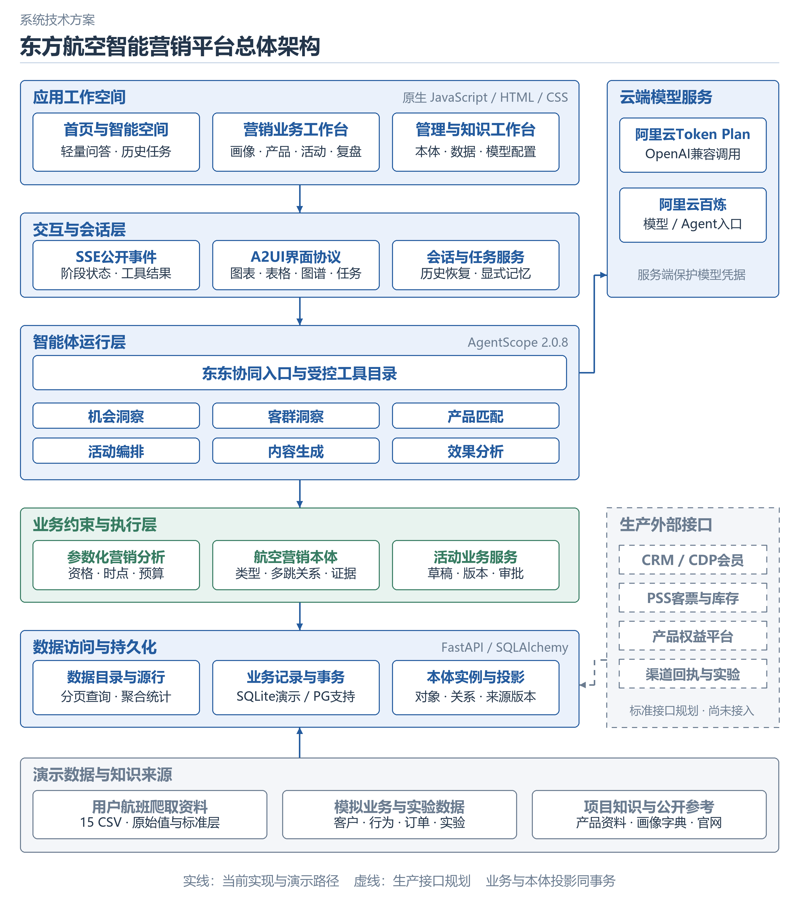

图 1  平台总体架构

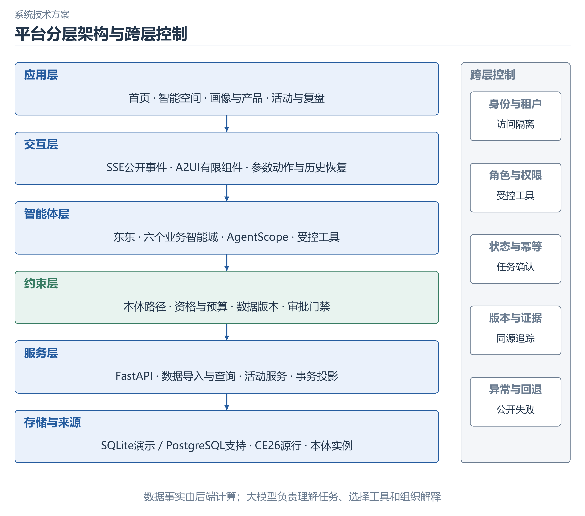

图 2  平台分层架构与跨层控制

表 3  目标与验收口径

| 目标 | 当前证据 | 后续验收要求 |
| --- | --- | --- |
| 数据可追溯 | 目录、源行、文件 SHA-256、CE26 版本及导入指纹 | 生产接口补齐来源系统、抓取时点和变更日志 |
| 推理有事实依据 | 七阶段后台计算、局部本体路径与规则检查 | 覆盖更多日期航线、延迟数据和未知资格场景 |
| 业务变更受控 | 用户及租户归属校验、待确认任务、保存前重算 | 真实审批职责、渠道幂等、撤回和补偿验证 |
| 交互可恢复 | 21 条 A2UI 消息、7 阶段、历史恢复实测 | 断流恢复、长会话、失败重试及移动端专项评测 |
| 算法可迭代 | 30,000 倾向样本、6,000 实验样本、34,576 库存快照 | 时序回测、校准、在线灰度及真实业务实验 |

### 技术创新点
第一项创新是把航空营销本体作为业务组合的约束层，而非仅供展示的知识图。对象类型、关系方向、版本、观测时点、资格状态和来源键共同参与计算。Flight→Cabin→Fare→Product 用于验证票价产品依据；Flight→Route→Airport 用于传播目的机场约束；ProductPackage→AncillaryProduct 用于定位权益规则。关系缺失或属性与源行不一致时，后台停止对应组合。
第二项创新是确定性计算与生成式解释协同。统计、金额、客群资格和关系路径由业务服务计算，大模型负责理解任务、选择受控工具及组织解释。节假日分析先产生可验证结果，再供模型概括。即使模型输出有波动，人数、预算与资格仍来自同一后端事实；空回复、工具失败和配置错误通过运行事件与 API 错误反馈，不能把未完成调用当作成功。
第三项创新是把交互结果与证据计算绑定。A2UI 以表面、组件和数据模型分别描述界面，后台工具输出直接形成 Chart、DataTable、MarketingStage 和 TaskCard。图谱节点可查看来源，用户修改参数后调用后台重算，保存动作携带当前会话中已持久化的真实表面，服务端核对所有者和租户。由此，图表与任务是同一次分析的结构化产物。
第四项创新是把建议、活动与证据形成持久链。确认保存时写入活动、冻结客群快照、内容与版本，并同步业务本体，保留 Recommendation→Evidence 与 Recommendation→Campaign。结果能够追溯到数据集键、记录键、观测时点、规则和操作者，后续复盘使用相同活动版本，而不是另建一份脱离方案的报表。
上述创新属于面向场景的系统方法与工程集成，不宣称发明新的基础模型或通用本体推理算法。本体也不是完成关联计算的唯一技术：SQL 与规则引擎可以实现这些条件，但在跨源对象复用、端点语义一致和证据路径维护上需要额外连接与治理逻辑。本项目把这些合同集中到一个可复用层，并提供关键关系忽略实验作为直接证据。

表 4  技术路线对比

| 维度 | 纯大模型问答 | 报表与分散规则 | 本项目实现 |
| --- | --- | --- | --- |
| 事实计算 | 易混入估计或生成值 | 报表口径明确，跨表关联分散 | 后台统计及资格函数产生事实 |
| 航空资格 | 依赖提示词表达 | 每个模块分别维护 | 类型关系与显式业务规则共同校验 |
| 解释依据 | 通常只有文字引用 | 可查报表，关系路径需重建 | 源行键、观测时点和多跳路径关联 |
| 业务执行 | 容易停留在建议文字 | 通过表单和流程执行 | 自然语言形成待确认任务，业务服务落库 |
| 交互结果 | 以文字为主 | 静态图表为主 | 同次分析生成 A2UI 图表、图谱及参数控件 |
| 评估边界 | 可能把归因当因果 | 需另设实验口径 | 分别呈现规则归因、ITT 与未执行 ROI |

## 实施方案
### 技术可行性分析
#### 数据来源与采集范围
数据分为公开参考、用户提供的爬取文件、项目知识资料和合成业务数据四类。公开参考用于理解服务分类及业务结构，不作为真实旅客、库存或交易数据。用户爬取文件保留原始航班、舱位、报价与权益说明，但原始采集接口和抓取时点未核验。模拟客户及业务记录用固定随机种子 20261012 生成，并通过外键、时间、金额、产品资格和标签窗口检查。

表 5  来源登记与使用边界

| 来源编号 | 实际资料 | 用途与边界 |
| --- | --- | --- |
| S01 S02 | 东航官网 https://www.ceair.com/zh/cny/home 及 https://www.ceair.com/ | 服务分类、产品语义和页面风格参考；未取得真实会员、价格或库存接口 |
| S03 | IATA NDC 公开标准介绍 | Offer、Order 和辅营分销结构参考；当前未实现完整 NDC 协议接口 |
| S04 S05 | klg.xlsx；画像维度及类型(1).xlsx | 产品字段、权益限制、画像维度及来源分类；不视为真实经营记录 |
| CRAWL-01 至 15 | 竞赛/06_数据/爬取结果/爬取结果 下 15 个 CSV | 70 列航班与报价原文、文件哈希、标准报价；captured_at 与 source_url 均未知 |
| SIM-CRM WEB PSS | 模拟会员、App 埋点、订座及客票系统 | 客户、企业、搜索、订单、航班及库存，全部合成 |
| SIM-PROD MKT | 模拟产品与营销系统 | 产品、曝光、辅营、活动、内容、触达及规则归因，全部合成 |
| SIM-EXP FEAT CAL KG OFFER | 模拟实验、时点特征、市场情景、本体及报价 | 训练与评估样本、关系输入、模拟报价，全部合成 |

表 6  用户爬取文件与可追溯标识

| 文件与来源 | 原始行数 | 计划日期范围 | SHA256 前12位 |
| --- | --- | --- | --- |
| 上海-乌鲁木齐.csv CRAWL-01 | 3,767 | 2026-09-10 2026-09-30 | 08a11dcecae5 |
| 上海-北京9、10、11月.csv CRAWL-02 | 21,659 | 2026-09-08 2026-11-30 | 588b9b45082d |
| 上海-广州.csv CRAWL-03 | 7,725 | 2026-09-10 2026-09-30 | 557f4064b4d8 |
| 上海-西安9月.csv CRAWL-04 | 3,059 | 2026-09-10 2026-09-30 | 0a4e9c14ca5f |
| 北京-上海9月.csv CRAWL-05 | 6,882 | 2026-09-09 2026-09-30 | 8c8ad4171e8b |
| 北京-乌鲁木齐9月.csv CRAWL-06 | 4,218 | 2026-09-10 2026-09-30 | 61fa6fd7fef2 |
| 北京-广州9月.csv CRAWL-07 | 7,473 | 2026-09-09 2026-09-30 | 48ac354a089d |
| 北京-西安9月.csv CRAWL-08 | 4,329 | 2026-09-09 2026-09-30 | fd4d28ed53ac |
| 广州-上海.csv CRAWL-09 | 7,354 | 2026-09-10 2026-09-30 | 1b34b73d3a0e |
| 广州-乌鲁木齐.csv CRAWL-10 | 2,950 | 2026-09-10 2026-09-30 | 6d9abf347786 |
| 广州-北京9月.csv CRAWL-11 | 6,578 | 2026-09-10 2026-09-30 | 0775533d4551 |
| 广州-西安.csv CRAWL-12 | 3,965 | 2026-09-10 2026-09-29 | 3f3c7e604df8 |
| 西安-上海9月.csv CRAWL-13 | 3,327 | 2026-09-10 2026-09-30 | b3fa60501c77 |
| 西安-乌鲁木齐.csv CRAWL-14 | 3,129 | 2026-09-10 2026-09-30 | 154fa71e0e69 |
| 西安-北京.csv CRAWL-15 | 4,299 | 2026-09-10 2026-09-30 | d7629acb8f29 |

来源登记中的 2026 年 10 月 12 日表示本项目访问或读取资料的日期，不代表用户爬虫的采集时间。爬取文件含计划日期 2026 年 9 月 8 日至 11 月 30 日，覆盖多航司、共享与中转记录；这些是来源报价及计划信息，不等于航班真实运行结果，也不等于成交票价。模拟业务跨度为 2025 年 10 月 1 日至 2026 年 9 月 30 日，模拟未来航班延伸至 2026 年 10 月 31 日。

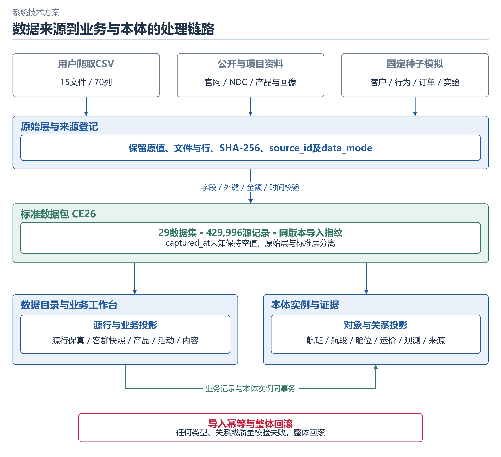

图 3  来源分层与数据到本体的处理链路

#### 数据规模与可用性
本地 CEA-COMPETITION 工作区已经导入 29 个数据集和 429,996 条源记录，版本命名空间为 CE26。该合计含来源清单、原始报价、标准报价、模拟业务及本体映射输入，同一业务事实可能在多个层次出现，因此不能把总行数解释成独立旅客或订单数。完整数据 Excel 有 33 个工作表，除业务数据外还含说明与字典等辅助页；平台导入的是其中 29 个支持的数据集。
平台中有 10,000 名模拟客户，形成六个互斥业务分群：价格敏感 1,993 人、企业差旅 989 人、休闲探索 1,637 人、会员沉默 1,376 人、商务高频 1,822 人、家庭出游 2,183 人，合计 10,000 人。分群来源为模拟数据标签，不是无监督聚类模型的训练结果。另有 19 个历史触达范围，可能重叠，不能与六个互斥分群直接相加。

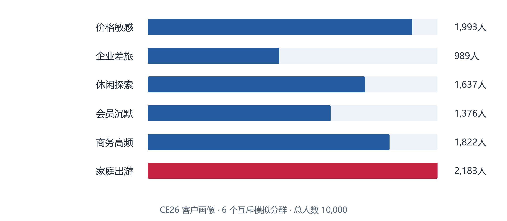

图 4  互斥模拟客群规模

本体导入新增 271,502 个对象和 410,417 条关系；保留原有 84 个对象和 84 条关系后，导入基线合计 271,586 个对象和 410,501 条关系。对象数量大于源“本体实体”表的 6,664 行，是因为航班、航段、舱位、运价、库存观测和标准报价等数据也被展开为本体实例。后续保存草稿会增加业务投影对象，基线数量不是永久不变的实时计数。
#### 知识与计算资源可行性
产品知识、画像目录和业务规则先进入知识处理流程，保留文档与片段位置，再进行本体候选抽取与类型关系校验。不是所有文本都适合直接成为正式事实：宣传性描述、有效期未知或语义不确定的内容可留在知识层，待人工审核后再进入业务本体。行业知识获取依赖有来源、可定位、可版本化的材料，而非大模型的常识记忆。
当前链路使用云端 OpenAI 兼容模型服务，已配置阿里云 Token Plan 与百炼提供商入口，最近真实验证模型为 qwen3.8-flash。供应商可配置并不代表每个模型已通过相同专项评估；应以具体模型调用报告为依据。本地 CPU 执行关系查询、统计和规则校验，原生 JS 渲染有限组件，不需要训练阶段算力。SQLite 满足当前单机演示，生产方案提供 PostgreSQL 驱动和容器部署路径；高并发、跨地域和大规模算法评分仍需专项压测。
#### 数据质量与证据限制
原始 CSV 共 90,714 行，完全重复 1,665 行、缺价格 8 行、中转原始行 18,396 行。平台完整保留原始层，标准报价层仅纳入去重后有完整价格的单航段报价，共 72,310 行。上述缺陷类别不能未经交集分析直接相减以推算标准报价数；转换结果以逐行准入程序及导入报告为准。
Wi-Fi 属性有 3 处冲突，标准化保留未知；不把舱位字母推导成真实库存，不把共享航班计为独立运力，不把中转全行程价格拆成航段价格。CNY 是国内报价场景假设，价格与产品规则未在线核验。模拟天气、市场假日窗口和未来航班标签均不冒充官方实测。使用这些边界，使“缺失”能够进入校验流程，而不是被静默补成有利结论。

表 7  数据问题与治理策略

| 问题 | 处理规则 | 营销决策影响 |
| --- | --- | --- |
| 重复与缺价 | 原始值保留，标准报价去重并排除缺价 | 标准报价数可复核，原文仍可定位 |
| 中转报价 | 保留整程原始粒度，不分摊到航段 | 当前单航段定价分析不使用这些行 |
| 抓取时点未知 | captured_at=null；query_date 仅是查询条件 | 不能做可靠历史价格趋势，也不能证明当前可售 |
| Wi-Fi 冲突与未知库存 | 状态保留未知，能力支持必须有明确证据 | 相关产品不因模型推断而通过资格 |
| 未来标签与画像穿越 | 特征时点早于评分；未成熟结果空值 | 历史回放拒绝未来画像和未来报价 |
| 含税净实付与规则归因 | 净实付=实付-退款；末次点击有 causal_effect=false | 不能描述为会计利润、因果增量或真实 ROI |

### 技术细节
#### 平台架构与关键模块
前端位于 apps/web-v32，采用原生 JavaScript、HTML 与统一品牌 CSS。首页保留东航官网式轻量对话入口，智能空间承担阶段过程、图表、图谱、历史会话和任务。后端 FastAPI 0.124.2 与 Pydantic 2.13.3 负责 API 与结构验证；SQLAlchemy 2.0.46 统一 SQLite 演示数据库与 PostgreSQL 部署连接；AgentScope 2.0.8 负责模型和工具运行适配；JSON Schema 负责 A2UI 协议消息验证。冻结原型 apps/web 不作为当前生产界面描述。
后端将业务状态与智能体运行解耦。数据导入服务负责幂等、完整性及映射；本体模块负责语义注册、关系端点与业务投影；助手服务负责会话、任务和记忆；节假日营销模块提供参数化分析与关系对照；原有活动服务负责审批、执行与复盘生命周期。跨模块写入通过业务服务与数据库事务完成，模型不能直接绕过权限向任意表写入。

表 8  关键实现与技术责任

| 模块路径 | 责任 | 关键合同 |
| --- | --- | --- |
| app/dataset_import.py | 29 个数据集导入及本体构建 | 同版本同内容幂等；失败整体回滚 |
| app/ontology/semantic_model.py | 对象类型、关系与域合同 | 关系方向、端点类型与扩展约束 |
| app/ontology/projection.py | 业务记录到本体投影 | 同事务同步，保留业务对象标识 |
| app/agents/agentscope_runtime.py | AgentScope 模型、工具、MCP 和事件适配 | 角色配置、租户上下文、公开事件及空回复检测 |
| app/assistant_tools.py 与 assistant_store.py | 受控查询、任务、历史与记忆 | 用户租户隔离，变更先形成待确认任务 |
| app/holiday_marketing.py | 节假日场景七阶段分析 | 时点过滤、客群资格、多跳关系与预算 |
| app/a2ui.py 与 assistant-a2ui.js | 协议消息与有限目录渲染 | 服务端 schema 校验，客户端禁止远程代码 |

#### 数据合同与全量数据清单
每个导入数据集登记 name、fields、pk、fks、grain、source、use 和 rows。源记录写入 dataset_rows 的 payload_json，保留记录键与常用查询键；dataset_key、namespace、import_job_id 和 fingerprint 使一个数据包的目录、明细和图谱可对应同一版本。查询限制当前租户，明细使用分页，单页限制 1–100 行，不向前端一次性返回全部数据。
下表列出本轮 29 个数据集。来源“模拟”表示全部业务数值合成；“混合”表示逐行保留模拟或爬取来源，查询时需要继续检查 data_mode 和 source_id。样本数据只证明数据管线具备训练输入结构，不证明已经训练预测模型。

表 9  CE26 已导入数据清单

| 数据集与键 | 行数 | 来源 | 粒度与用途 |
| --- | --- | --- | --- |
| 来源清单 CE26-sources | 30 | 来源登记 | 一个数据来源；数据目录、来源追溯 |
| 机场目录 CE26-airports | 36 | SIM-PSS/CRAWL-* | 一个机场；本体机场、航线关联 |
| 航线目录 CE26-routes | 179 | SIM-PSS/CRAWL-* | 一条有向航线；机会洞察、航班预测、客群航线偏好 |
| 企业客户 CE26-enterprises | 120 | SIM-CRM | 一家企业；ToB画像、企业差旅 |
| 客户画像 CE26-customers | 10,000 | SIM-CRM | 一个客户截至数据截止日的画像；画像、客户聚类、会员与企业运营 |
| 产品目录 CE26-products | 12 | SIM-PROD | 一个产品版本；产品匹配、推荐、内容事实 |
| 航班计划 CE26-flights | 6,336 | SIM-PSS | 一个航班运行日期；航班查询、运价场景、预测标签 |
| 营销活动 CE26-campaigns | 19 | SIM-MKT | 一个活动版本；活动编排、审批、执行 |
| 内容素材 CE26-contents | 57 | SIM-MKT | 一份渠道素材版本；内容工作台、活动引用 |
| 搜索行为 CE26-events | 48,410 | SIM-WEB | 一个埋点事件；意向识别、漏斗、购买倾向 |
| 客票订单 CE26-orders | 14,528 | SIM-PSS | 一个订单航段；购买标签、退款、渠道转化、价值 |
| 产品曝光 CE26-exposures | 38,640 | SIM-PROD | 一次产品曝光；产品推荐、曝光校正 |
| 辅营交易 CE26-ancillaries | 5,692 | SIM-PROD | 一次辅营购买；推荐标签、权益偏好、履约分析 |
| 航班库存与预测样本 CE26-inventory | 34,576 | SIM-PSS | 一个航班在一个观测时点的库存；航班预订曲线、预测与供给窗口 |
| 触达回执 CE26-touches | 18,735 | SIM-MKT | 一个触达尝试；频控、执行、渠道分析和归因 |
| 订单归因 CE26-attribution | 46 | SIM-MKT | 一个订单的末次点击归因；效果复盘、收入来源解释 |
| 购买倾向训练样本 CE26-propensity | 30,000 | SIM-FEAT | 一个客户在一个评分时点；购买倾向模型训练与评估 |
| 营销增量实验样本 CE26-experiment | 6,000 | SIM-EXP | 一个客户一次随机入组；Uplift训练、实验组对照组比较 |
| 市场日历 CE26-calendar | 396 | SIM-CAL | 一个日期的市场情景；预测外生变量、市场洞察 |
| 本体实体 CE26-entities | 6,664 | SIM-KG/CRAWL-* | 一个本体对象；本体导入、关联查询 |
| 本体关系 CE26-relations | 6,789 | SIM-KG/CRAWL-* | 一条有向关系；图谱演示、证据关联 |
| 爬取航班原始明细 CE26-crawl-raw | 90,714 | CRAWL-* | 一个CSV报价航段行，不代表订单；爬取结构参考、原始回溯 |
| 爬取文件清单 CE26-crawl-files | 15 | CRAWL-* | 一个CSV文件；原始来源与导入质量 |
| 爬取航班标准目录 CE26-crawl-flights | 14,239 | CRAWL-* | 一个源航班信息ID；航班查询、实际承运与共享航班辨识 |
| 爬取票价产品目录 CE26-crawl-products | 30 | CRAWL-* | 航司、产品代码、标签及说明相同的一个源版本；票价权益、资格字段参考及内容事实 |
| 爬取单航段标准报价 CE26-crawl-offers | 72,310 | CRAWL-* | 一条保留原始票价语义的单航段报价；航班报价查询与票价产品展示，不直接训练历史价格走势 |
| 模拟航班报价_爬取结构 CE26-sim-offers | 25,344 | SIM-OFFER | 一个模拟航班、产品和报价观测时点；演示航班搜索、票价权益、内容和问答输出 |
| 爬取字段映射 CE26-field-mapping | 70 | 字段适配规则 | 一个源字段；标准接口与导入适配 |
| 爬取质量说明 CE26-crawl-quality | 9 | 爬取文件检查 | 一个质量事项；演示口径与导入治理 |

核心关联以 airport_code、route_id、flight_id、customer_id、order_id、product_id、campaign_id 为基础。订单、行为和交易保留关联键，便于计算曝光到购买和触达到订单的关系；本体不建立个人旅客对象，采用 CustomerAggregate 与 AudienceSnapshot 表达运营群体。个人级模拟客户与订单留在数据层，在助手输出中只展示聚合统计与资格人数。

表 10  重要字段与业务语义

| 对象 | 关键字段 | 语义与使用 |
| --- | --- | --- |
| 客户画像 | business_segment、member_tier、preferred_route、profile_as_of | 截止日画像、互斥分群与会员资格；不是任意历史时点特征 |
| 渠道授权 | app_consent、sms_consent、wechat_consent、protected | 逐渠道同意与保护名单，资格规则输入 |
| 搜索行为 | event_at、route_id、flight_id、passenger_count、session_id | 近期意向和同行证据，窗口必须早于观测时点 |
| 航班与报价 | departure_at、marketing_flight_no、operating 信息、currency、captured_at | 运行日期、共享识别、报价时效和币种 |
| 库存观测 | flight_id、observed_at、available_seats、synthetic | 仅取评分时点前最后快照，模拟供给不得冒充真实库存 |
| 时点特征 | feature_cutoff、last_feature_event、label_end、label_complete | 防止未来泄漏，成熟标签才可评估 |
| 来源与版本 | source_id、data_mode、dataset_key、record_key、namespace | 事实追溯、版本隔离与展示标识 |

#### 爬取结构适配与导入事务
用户 CSV 的 70 列结构作为适配基准。原始层保留列顺序及原文，附加 raw_record_id、source_id、文件与行定位；标准层解析机场、航线、航班、舱位和票价产品，将营销航司与实际承运含义分离。票价产品目录 30 项与模拟辅营产品 12 项分别建模，不能把含权益的票价产品直接等同于一项辅营服务。
导入流程先计算文件与包指纹，检查字段、主键、外键、金额和时间，再写源明细与本体。导入前采用 SQLite backup API 做一致性备份。相同 namespace、相同内容再次导入复用已有版本；同版本内容改变拒绝覆盖。类型或关系校验失败时事务回滚，防止出现业务表成功、本体失败的半成品。既有总部租户与竞赛租户隔离，不用竞赛导入覆盖总部数据。
导入完成后逐表核对数量，并将 429,996 条入库 payload 与输入 JSON 逐条比对。SQLite integrity_check 和外键检查通过，既有总部租户与导入前备份一致。此导入只作用于当前本地数据库；Git 提交与推送保存代码和文档，不会自动把本地数据、模型配置或凭据同步到远程运行环境。
#### 航空营销本体与实例模型
本体由模式、实例、约束和证据四个部分组成。模式定义类型与关系端点；实例代表某版本中的航班、产品、客群与活动；约束控制对象组合和行动资格；证据把实例属性、规则结果和来源行连接起来。当前实现使用数据库对象关系、类型注册与 Python 规则遍历，并提供已有 OWL 导出资料；不把静态 OWL 文件当作正在运行的外部推理服务。
供给链以 Route、Flight、FlightSegment、Airport、Cabin、Fare、Product 和 MetricObservation 表示航线、航班、行程与时点观测。营销链以 CustomerAggregate、AudienceSnapshot、ProductPackage、Campaign、CampaignVersion、ContentAsset、Feedback 与 AttributionResult 表达方案与反馈。Recommendation、Evidence、HumanDecision 和 AgentRun 用于定位建议依据及责任。

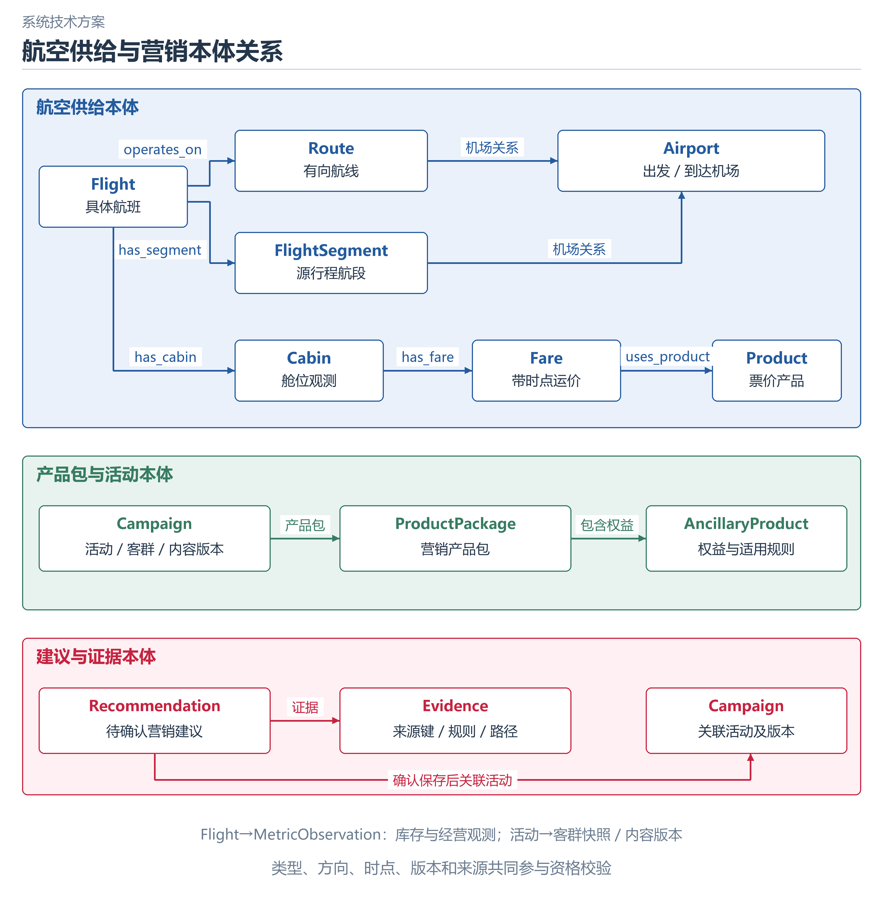

图 5  航空供给与营销本体核心关系

表 11  关键关系与校验含义

| 关系 | 源类型→目标类型 | 作用 |
| --- | --- | --- |
| operates_on | Flight→Route | 保证航班归属所选航线 |
| has_segment 与 departs_from/arrives_at | Flight→FlightSegment；Route/FlightSegment→Airport | 机场路径一致性与目的地约束传播 |
| has_cabin、has_fare、uses_product | Flight→Cabin→Fare→Product | 定位有时效、币种和来源的票价产品依据 |
| includes_ancillary | ProductPackage→AncillaryProduct | 定位权益版本、有效期与资格 |
| has_metric | Flight→MetricObservation | 取观测时点前库存快照 |
| targets_audience 与 uses_product_package | Campaign→AudienceSnapshot/CustomerAggregate；Campaign→ProductPackage | 冻结受众与所用产品包 |
| has_campaign_version 与 generates_content | Campaign→CampaignVersion→ContentAsset | 活动和渠道内容的版本一致性 |
| supports_campaign 与 has_evidence | Recommendation→Campaign；Recommendation→Evidence | 保存建议与可追溯证据 |

对象采用稳定 external_id，CE26 前缀隔离本轮源版本。端点校验要求关系两侧类型符合注册合同，错误方向或错误类型不进入有效邻接。图谱不是由模型即时画出的装饰：节假日模块从存量 OntologyRelationRecord 查询边，加载属性并与数据层进行一致性比对，再生成局部路径。总览最多显示 300 个对象，邻接查询分页，避免浏览器加载全量几十万节点。
#### 本体约束如何进入计算
设观测时点为 t，出行窗口为 W，航线为 r。有效航班集合要求 departure_at∈W、存在 Flight→Route(r)、航线与航段机场一致、存在 Flight→Cabin→Fare→Product，且模拟 Fare 的 captured_at≤t、币种为 CNY、来源与业务属性一致。系统为每条通过和阻断结果保留规则说明；关系缺失不以默认值替代。
库存值取同一航班 observed_at≤t 的最新模拟 MetricObservation。公开爬取报价作为独立参考展示，captured_at 未知时不能进入时效已通过的供给链。产品有效期需覆盖 W；Wi-Fi 只接受明确支持的航班；接送只接受目的机场 SYX 或 KMG 的模拟范围；家庭邻座需要近期两人以上同行搜索证据，不能只凭家庭标签；里程产品筛选普通或银卡会员。未接入旅客、舱位和上游可售条件时状态仍为待核验。
客群集合由近期意向或航线偏好产生，再排除渠道未授权、保护名单、7 日频控超限和已经出票者。产品与客群交集决定本轮可计划人数。设允许人群数为 A、产品候选人数为 P、预算为 B、单位触达假设成本为 c，则计划人数 N=min(A,P,⌊B/c⌋)，触达开销为 N×c。App、短信、微信假设成本分别为 0.10、0.30、0.08 元/次；这些不是已核验的东航成本，也不含优惠补贴和权益采购。

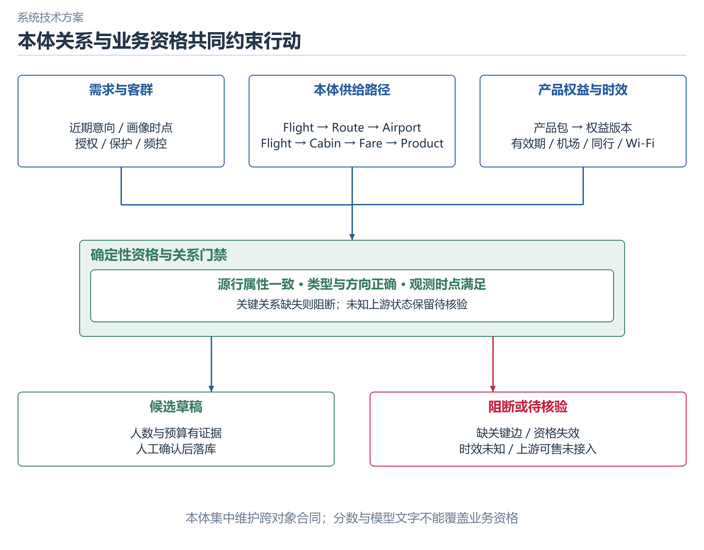

图 6  本体路径与资格约束共同形成行动门禁

核心价值在于把“需求候选”变成“有依据且满足组合条件的候选方案”。一个标签检索无法同时证明行程、供给、权益与渠道资格；单条文档检索不能证明当前版本的 Flight 与 Fare 连通；自然语言生成不能证明 source_id 与观测时点。其他技术能够通过显式连接和规则实现，但必须维护这些语义合同。本体使跨源路径、资格条件和证据对象共享标识，并在同一规则执行中检查。
#### 关键关系忽略对照
POST /api/holiday-marketing/compare 对同一参数分别运行基线与忽略指定关系的计算。可选择 operates_on、uses_product 或 includes_ancillary；忽略只作用于本次邻接构建，不删除原始图谱。该实验用于展示系统确实依赖已入库关系约束，而不是仅把图谱画在结果旁边。
本地上海浦东至三亚家庭场景的基线为 7 个关系链有效航班、11 个进入候选核验的产品、ready=true；忽略 uses_product 后，有效航班与产品均为 0，ready=false。ready 仅表示可以形成模拟草稿，不表示真实渠道批准或上游可售。三类关键关系缺失均有回归测试。该对照验证的是“当前系统门禁依赖这些关系”，不能据此推出任何无本体系统都绝对无法实现同样功能。

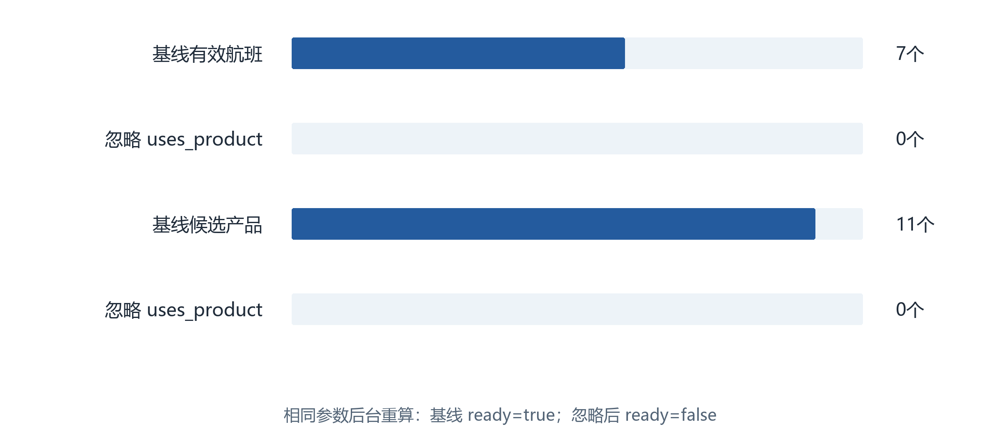

图 7  同参数关系忽略实验的后台重算结果

#### AgentScope 运行与智能域协作
智能体采用统一的 AgentScopeRuntime 适配层，按配置加载角色提示、技能目录、租户工作空间、MCP 工具和 Python 业务工具，构建 Agent、ContextConfig、ReActConfig、Toolkit 和 OpenAIChatModel。模型回复使用 reply_stream，框架事件转换为平台公开事件。当前角色是可组合的业务配置，不应描述为所有角色在每次问答中同时独立运行。
六个业务智能域分别负责机会、客群、产品、活动、内容和效果，东东承担跨域入口，数据处理角色负责材料解析与候选准入。机会域还定义市场信号、航线经营和产品商业化等细分角色。按职责拆分减少混用工具和知识上下文，统一运行层则保证事件、来源和错误处理一致。

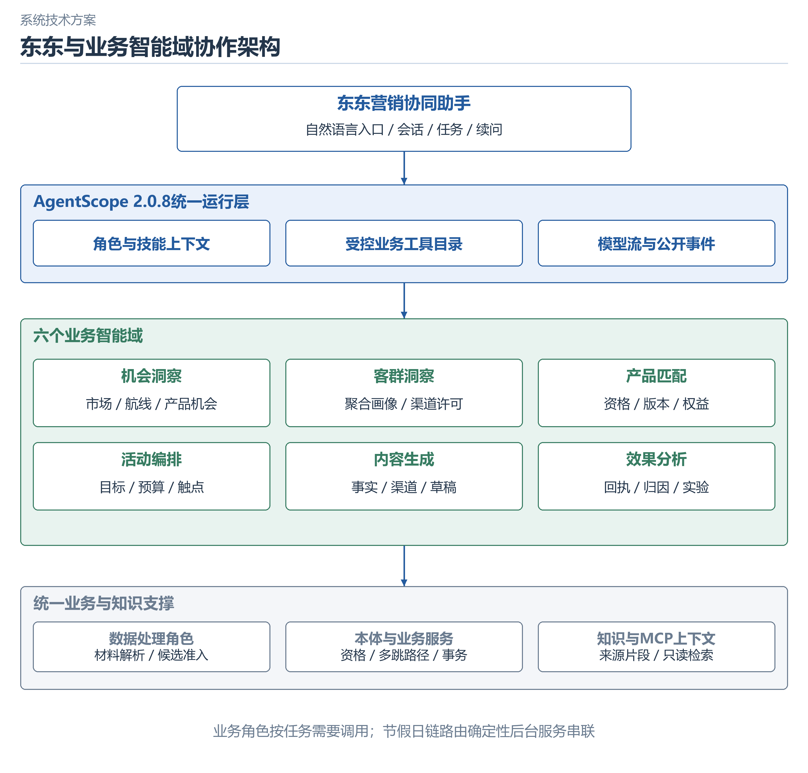

图 8  东东与六个营销智能域的协作边界

表 12  智能域输入输出合同

| 角色 | 读取的主要事实 | 输出与责任 |
| --- | --- | --- |
| 机会洞察 | 市场信号、航线、航班和经营观测 | 带来源与时间范围的机会候选 |
| 客群洞察 | 聚合画像、授权、近期意向和保护规则 | 可计算客群及快照候选，避免个人身份输出 |
| 产品匹配 | 产品版本、权益限制、行程与资格 | 可用或待核验组合与排除原因 |
| 活动编排 | 目标、客群、产品、预算与渠道 | 活动策略、触点计划和待确认任务 |
| 内容生成 | 事实、客群需求、方案及渠道规范 | 可审核文字与内容版本，不虚构价格权益 |
| 效果分析 | 回执、订单、退款、归因和实验 | 统计、口径说明、异常与复盘建议 |
| 东东与数据处理 | 平台 API 目录、历史、显式记忆、知识 schema | 跨域查询与任务；解析材料并生成受审候选 |

MCP 提供本体、知识、产品与业务上下文等受限读工具。业务变更通过平台任务和业务 API，不通过 MCP 直接任意写库。东东工具包括 query_platform、query_statistics、节假日分析、prepare_platform_task 和页面导航，使用允许的 API 目录。工具调用携带当前用户与租户上下文，复用后台认证、权限和校验。
#### 东东自然语言任务执行链
通用问答由模型结合受限工具读取当前租户业务。节假日场景先识别明确意图并解析航线、日期、客群、产品、渠道和预算，继承当前会话已确认的参数；不支持或未指定日期的节假日应请求补充，不悄悄替换为另一节日。参数通过 Pydantic 校验，观测时点必须早于出行窗口。
随后后台分析七阶段生成数据事实与界面表面，再交 AgentScope 模型组织简短结论。续问如“预算改为 500 元”复用当前场景其他参数，重新调用后端，而非只改显示数字。“保存当前活动方案为草稿”创建待确认任务；确认时重新执行资格、关系、预算与归属校验，然后进入业务事务。后台错误通过明确状态返回，模型未完成回复或工具失败不标为成功。

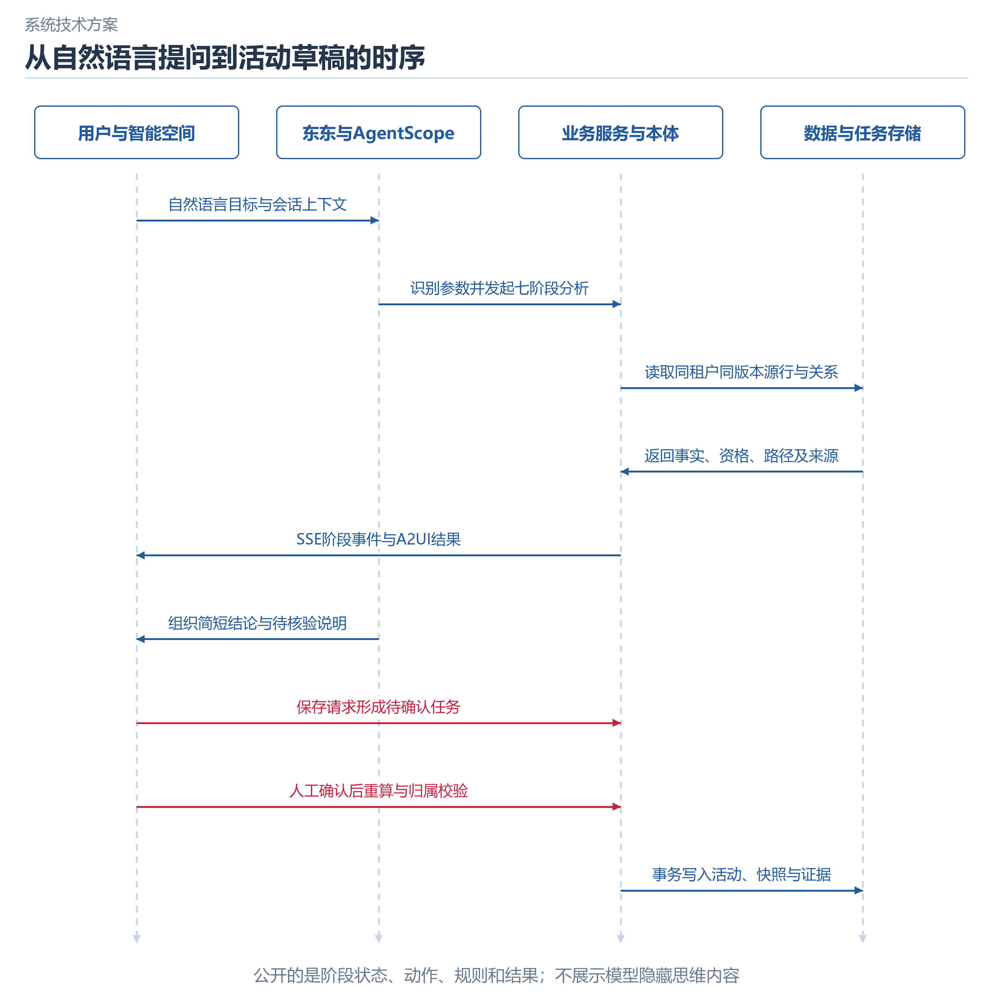

图 9  东东从提问到活动草稿的时序

会话、消息、任务和显式记忆按 tenant_id 与 user_id 持久化。历史加载恢复文字、A2UI、公开事件和任务状态。记忆保存用户明确要求的偏好或约束，限制在当前用户和租户，不作为事实库替代品；保存“偏好 App 渠道”仍需查询实际渠道授权。当前记忆为可管理的显式持久化条目，不宣称具备未经验证的自主长期学习或跨用户知识共享。
#### A2UI 协议与多样化交互
平台采用 A2UI v0.9.1 wire schema，目录标识为 ceair-marketing:assistant-v1。每个业务表面依次产生 createSurface、updateDataModel 和 updateComponents；JSON Pointer 连接组件与数据模型。七阶段共生成 7 个表面、21 条消息，经服务端 JSON Schema 校验并通过 SSE 传输，客户端使用原生 DOM 目录渲染。
平台复用 Text、Column、Row、Card、Button 与 Divider，并扩展 Chart、DataTable、TaskCard 与 MarketingStage。扩展组件属于平台自定义目录，不将其描述为 A2UI 所有标准渲染器原生支持。后端事实驱动图表和表格，组件只呈现已计算值；客户端不接收模型生成的 HTML、脚本或任意远程代码，JSON Pointer 拒绝危险原型键。
Chart 支持柱状、适用时的占比、明细与 CSV 导出；百分率或不可相加的计数不强制展示合计与饼图。MarketingStage 包含指标、规则通过与排除、数据表、来源、图谱路径和参数控件。图谱节点点击可查看类型、source、dataset、record 与观测属性。用户动作回传经 schema、会话归属和权限验证后调用业务服务，形成“展示—调整—重算—确认”的闭环。

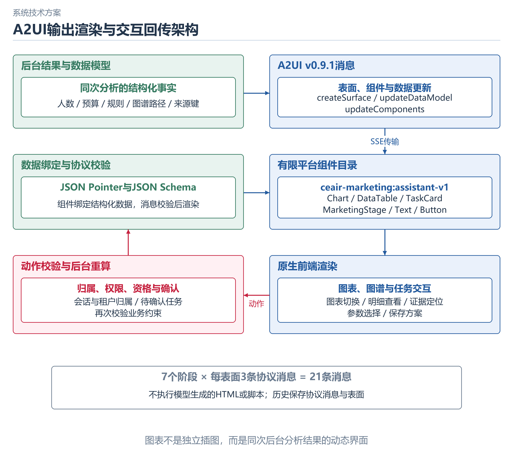

图 10  A2UI 表面 数据模型与交互动作

#### 公开过程与错误可观测性
AgentScope 的模型开始结束、工具调用与结果事件转换为平台 harness 事件。节假日后台发出 7 对 marketing/stage-started 与 stage-completed 事件，共 14 个公开业务事件。用户看到执行阶段、工具输出、规则检查、数据依据和决策说明，可折叠过程。ThinkingBlock 相关内部内容不直接暴露；这里的“推理过程”指可检查的业务计算与证据链。
系统分别处理认证/权限错误、参数不支持、数据集缺失、画像时点不满足、关系链阻断、模型配置不可用、工具异常与模型空回复。API 使用结构化错误或 4xx 状态；运行层记录公开失败事件，前端显示错误并保留历史。空回复检测避免把停滞流或仅工具中间结果视为最终成功。性能监控应继续增加首个结构化结果时间、完整回复时延、工具失败率和任务完成率的分位统计；当前仅有单次真实调用时延，不推导平均 SLA。
#### 节假日营销完整案例
演示输入为“请用已导入的数据做 2026 年国庆上海到三亚的家庭出游活动营销，展示图表、本体约束、证据路径与完整过程”。后台解析 R-PVG-SYX、家庭出游、App、P-FLEX、预算 20,000 元，观测时点为 2026 年 9 月 30 日，窗口为 10 月 1 日至 7 日。用户进入智能空间可查看完整交互，首页仍以简洁问答为主。

表 13  七阶段结果及展示组件

| 阶段 | 计算与事实 | 展示及用户操作 |
| --- | --- | --- |
| 场景与版本 | 校验窗口、画像时点、数据包与参数 | 参数表单、数据版本与范围 |
| 需求与航线 | 近期行为及航线偏好形成需求候选 | 航线需求图与明细，选择其他航线重算 |
| 客群资格 | 候选 168 人，触达资格通过 147 人 | 授权、保护、频控与已出票检查 |
| 航班供给 | 窗口 7 个模拟航班，完整关系链通过 7 个 | 航班表、库存观测与爬取参考分列 |
| 产品与本体 | P-FLEX 候选上限 147；Wi-Fi 排除；接送依目的机场进入候选 | 证据路径、节点来源、规则与关键边忽略对照 |
| 活动方案 | 一次 App 触达计划 147 人，假设开销 14.70 元 | 预算、渠道、内容候选与保存草稿动作 |
| 效果评估 | 历史随机实验 ITT；本次尚未执行 | 实验图表、来源清单、ROI 待定及复盘建议 |

家庭邻座产品的候选人数不是 147 人：本轮只有 3 人具有两人以上同行搜索证据，出票时仍需再次核验。家庭画像、同行证据和产品适用性分别呈现，体现对象约束的差异。默认 P-FLEX 也保留上游可售、旅客与舱位资格待核验，不在文案中承诺一定可购买。

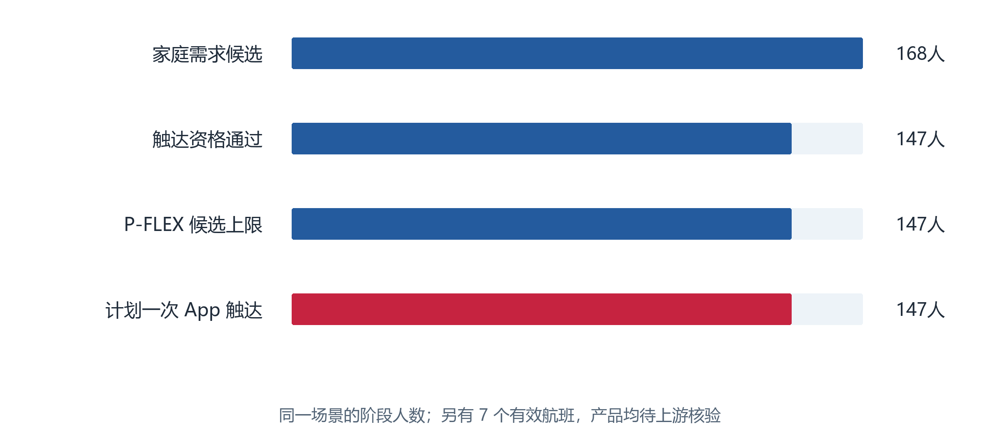

图 11  家庭场景资格人数与供给结果

历史中另一轮价格敏感客群续问“预算改为 500 元”后，系统保留 R-PVG-SYX，输出计划 124 人、假设触达成本 12.40 元；这属于另一客群结果，不能与家庭 147 人混为同一次分析。该轮实际模型 qwen3.8-flash 完整回复耗时 23.36 秒，结构化表面在 complete 前出现，7 阶段、21 条 A2UI、12 个来源、历史恢复均完成。首轮真实调用约 38.67 秒，二者是本地单次样本，不是平均性能指标。
#### 活动落库与状态闭环
点击保存先生成 AssistantTask，服务端要求 action 来自当前用户、当前租户且已保存对话中的真实 surface。同参数重复点击复用待确认任务。用户确认后再次分析，写入活动、精确人数的 AudiencePackage 与冻结 AudienceSnapshot、产品包引用、内容草稿及 CampaignVersion，并同步本体 Recommendation、Evidence 与 Campaign 关系。
这一步只形成草稿。后续应按运营审批、产品核验、渠道可用性及预算审核进入待执行与执行批次。渠道发送必须通过审批和真实上游接口，本轮没有调用真实短信、微信或 App 投放系统。演示保存验证产生了一条家庭营销草稿，人数 147，状态为草稿；新增建议证据投影另由回归测试验证，避免把较早保存的记录误作新功能证据。
活动闭环的关键是版本一致：审批的客群、产品、内容与预算必须是执行引用的版本；反馈回收到对应批次与版本，订单及退款按统一时间窗关联。状态变化与操作者有审计依据，避免历史活动数据导入后自动恢复为可执行状态。19 个历史活动和 57 份内容用于复盘与查询，不视为当前待发送任务。
#### 统计口径与效果评估
描述性统计、规则归因和因果评估分别处理。净实付为含税 paid-refund，不是利润。规则归因采用七日末次点击，最多归因一次，标注 causal_effect=false；它说明关联来源，不能证明营销造成的增量。当前活动未执行，真实成本和结果缺失，ROI 保持待定。
模拟随机实验样本共 6,000 人，对照组 3,002 人、出票 80 人，干预组 2,998 人、出票 67 人；7 日出票率分别为 2.665% 和 2.235%，差值约 -0.430 个百分点。按随机分配组计算 ITT，不因失败送达或未点击而剔除人员。这个结果不证明本次活动有效，也不推断干预必然负效；需要置信区间、实验设计和更多真实样本共同判断。

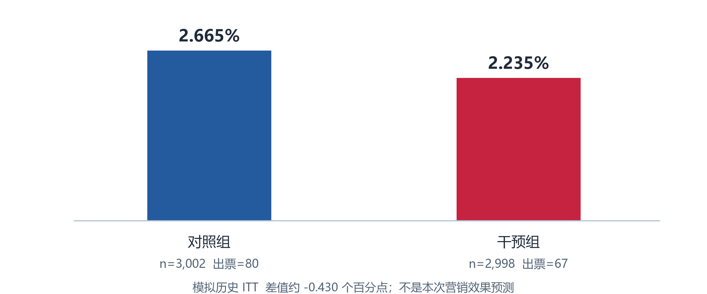

图 12  模拟历史随机实验的出票率

后续真实评估应预先定义主指标、分析窗口、随机化单元、样本量、停止规则、渠道干扰和退款成熟期。以客群与航线分层随机，留出稳定对照，检查组间特征平衡，避免同时投放多个活动造成归因污染。业务目标可以是增量出票、辅营净收益或退订风险，但不得用点击率单独替代最终目标。
#### 算法模型扩展方案
当前已运行的是聚合统计、显式资格规则、关系路径校验和大模型解释。尚未训练购买倾向、需求预测、Uplift 或推荐排序模型。算法扩展采用“规则保证可行性、预测辅助排序、本体约束组合、实验检验增量”的分工，算法分数不覆盖渠道授权、保护规则或上游可售核验。
购买倾向模型以评分时点前 7/30/180 日搜索、报价、会话、出票、金额、辅营和最近出票间隔为输入，标签为评分后 7 日出票。以逻辑回归作校准基线，LightGBM 或 CatBoost 作非线性候选。评分结构包括 tenant、customer 匿名键、score_as_of、purchase_probability、model_version、feature_version 与主要贡献特征；输出可以聚合到 AudienceSnapshot，个人级分数不直接进入公开图谱。
30,000 个样本有 705 个正例，约 2.35%，应关注 PR-AUC、Lift@K、Brier 与校准曲线，不能只用准确率；全预测为负仍可能获得高准确率。按时间切分并核查客户重复与窗口重叠，不能用最终客户画像 observed_orders、净实付汇总或未来 actual 标签代替历史特征。类别权重、阈值和重采样仅在训练集内确定，测试保持原分布。
需求与库存预测以 34,576 条模拟航班快照为结构起点，先做同航线同星期基准、预订曲线与历史分位数，再比较回归或分位数模型。输入只包含当时可见的 days_to_departure、预订数、可售快照和已知日历；同一航班全部快照必须在同一划分，避免泄漏。WAPE、MAE、分位损失和覆盖率是可选指标，真正目标取决于库存系统能够提供的成熟实乘标签。
Uplift 模型使用随机分组与成熟出票结果，先报告 ITT 与异质性，再考虑双模型、T-learner 或 DR-learner。正结果稀少，6,000 人只适合验证管线与基础方法，不足以保证稳定的细粒度营销增量。评估应使用随机留出、AUUC/Qini、策略价值置信区间和成本敏感净收益；生产阶段需前瞻随机实验，不能把规则归因数据直接当无偏因果标签。
产品推荐先执行本体资格过滤，再使用曝光与未购买样本学习排序。38,640 次曝光和 5,692 次辅营交易提供模拟结构，但必须检查产品 eligibility、标签成熟、曝光选择偏差与同一订单泄漏。候选方案可采用逻辑回归购买评分或 Learning-to-Rank，指标为合资格候选上的 Recall/NDCG 及在线增量；没有曝光记录的未购买不能直接补成负样本。

表 14  算法建设计划与验收

| 模型 | 样本与特征 | 离线指标 | 上线门禁 |
| --- | --- | --- | --- |
| 购买倾向 | 30,000 时点样本；近期行为与历史购买 | PR-AUC、Lift@K、校准与分组稳定性 | 优于基线且无泄漏，影子评分后灰度 |
| 航班需求 | 34,576 库存快照；预订曲线与提前期 | MAE/WAPE、分位损失及区间覆盖 | 真实标签成熟，航班级时序回测 |
| 营销增量 | 6,000 随机实验样本；治疗与结果 | ITT、AUUC/Qini、策略价值区间 | 样本量与正例充足，真实随机实验 |
| 产品排序 | 38,640 曝光、5,692 辅营交易 | 合资格 Recall/NDCG、校准 | 本体资格先过滤，版本与成本可核验 |

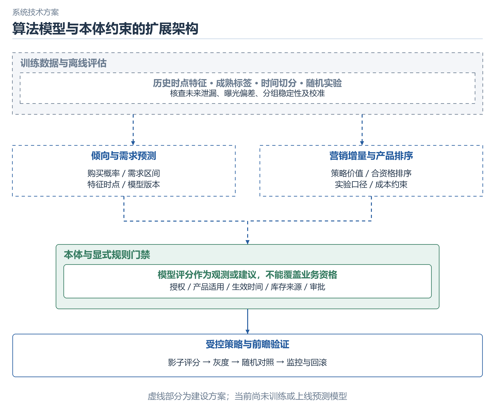

图 13  预测模型与本体约束的扩展位置

算法服务建议提供 POST /score 和 GET /models/version 合同，返回特征观测时点、模型版本、数据版本、置信或校准信息及解释字段。模型结果作为带来源的 MetricObservation 或 Recommendation 候选，不伪装成实际经营事实。模型漂移、资格失效、特征缺失或超时应降级到统计基线或人工核验，保留降级原因。当前此服务合同为规划，未实现部署或宣称性能。
#### 安全 权限与运行部署
平台通过登录 token、租户上下文与角色控制业务读写；会话、记忆、任务、数据目录与图谱查询均限定用户或租户。模型凭据由服务端 Fernet 机制保护，文档、日志和 Git 不包含 API Key、登录 token 或运行数据库。正式部署需要妥善托管加密主密钥和 登录 token 签名密钥，避免生产使用演示账号。
写操作先形成待确认任务，确认时再次检查角色、会话、数据与业务状态。A2UI 禁止任意代码，动作只允许平台定义的事件；来源表面归属验证防止篡改数据触发操作。知识内容被视为输入材料，不能作为覆盖平台权限的指令。个人画像在数据层，助手对外呈现聚合结果；真实上线仍需完成数据最小化、用途与同意范围核验及留存策略。
仓库具有容器与 PostgreSQL 部署支持及 CI/CD 文档。当前功能验收运行在本地网页 8784 与 API 8804，使用既有演示数据库；部署能力不等于最新功能已在远程环境验证。远程升级应独立执行数据库迁移、导入及健康检查，配置真实接口密钥，并验证回滚、备份恢复和静态资源路由。当前未提供生产级并发吞吐、可用性或灾备 SLA。
#### 测试结果与验收边界
最近全量 API 测试为 131 项通过，用时 213.02 秒；节假日专项 9 项在最终标签修正后再次通过。全部 15 个 web-v32 JavaScript 文件通过 node --check，Python 编译与 git diff --check 通过。单元与 API 测试主要验证确定性服务和受控模型路径，真实模型验证单独执行；两类证据不能混为 131 次真实大模型成功调用。

表 15  验证项目与结果

| 验证项 | 证据 | 结论与限界 |
| --- | --- | --- |
| 源数据保真 | 429,996 条 payload 与输入 JSON 逐条一致；完整性与外键检查通过 | 数据导入可复现，不代表生产数据真实性 |
| 租户隔离 | 总部与备份一致；API 隔离专项测试 | 竞赛数据不跨租户污染 |
| 关系约束 | 三类关键关系缺失测试；uses_product 网页/API 对照为 0/0/false | 当前门禁真实依赖入库关系 |
| 时间与未知值 | 未来画像、未来报价、未知库存及资格测试 | 未知保持待核验，历史不读未来事实 |
| A2UI 与历史 | schema 测试；真实流 7 阶段/21 消息/12 来源；历史一致 | 结构化交互与消息持久化联动 |
| 任务执行 | surface 所有者、去重、草稿及本体投影测试；草稿实测 147 人 | 仅保存草稿，未调用真实渠道 |
| 模型响应 | qwen3.8-flash 实测 23.36 秒续问，首轮约 38.67 秒 | 单次样本，不作为平均时延或 SLA |
| 工程检查 | 131 项 API、9 项专项再测、15 JS 语法检查 | 不是大规模负载、渗透或生产试点认证 |

后续验收采用分层方法：数据层检查字段、金额、主外键、时间和来源；本体层检查端点、关系完整性、属性一致与失效；工具层检查目录、权限、幂等、错误和确认；模型层检查事实引用、工具选择、空回复与反事实输入；UI 层检查表面恢复、可访问性、动态图表和参数联动；业务层检查版本、审批、渠道回执与实验口径。未完成生产压测、渗透测试和真实收益试验的项目应作为后续工作，不填成已通过。
#### 标准接口与生产数据接入
当前 GET /api/datasets、/{dataset_key}/rows、/{dataset_key}/summary 提供数据目录、分页明细与有限分组聚合。GET /api/ontology/entities 与 /{external_id}/neighbors 提供对象和邻接检索。POST /api/holiday-marketing/analyze、/compare 与 /drafts 分别负责参数化分析、关系对照与受控草稿落库。所有业务接口复用租户和权限上下文；字段、状态与错误合同可在 API 文档中核对。
生产接入应采用源系统稳定键、occurred_at、captured_at、effective_from/to、source_system、record_version 和 data_mode，区分业务发生、观测、采集和生效时间。PSS 接口补齐真实可售舱位和报价过期时间，产品平台补齐权益资格与履约范围，CDP/CRM 补齐用途内画像和授权，渠道平台补齐批次幂等与回执，实验平台提供随机分配与成熟结果。只有经过字段映射和质量校验的数据才能投影到本体，并保持同一版本。

表 16  生产接入清单

| 源系统 | 需要的数据 | 替换当前模拟部分 |
| --- | --- | --- |
| CRM/CDP/会员 | 匿名客户键、时点画像、会员、企业和授权 | SIM-CRM；聚合客群与同意范围 |
| App/官网事件 | 用途合规的事件、会话、航线和出行窗口 | SIM-WEB；近期需求与时点特征 |
| PSS/客票/NDC 网关 | 真实航班、舱位、报价、期限、出票与退款 | SIM-PSS/OFFER；不能仅靠爬取报价替代 |
| 产品权益平台 | 规则版本、库存、机场与旅客舱位资格 | SIM-PROD；产品可售及履约核验 |
| 营销渠道 | 发送批次、请求幂等键、送达、点击、退订与失败 | SIM-MKT；真实执行与频控 |
| 实验与特征平台 | 随机分配、结果窗口、特征版本与评分记录 | SIM-EXP/FEAT；模型与因果评估 |

### 计划和分工
项目已完成可运行系统、数据导入与本体映射、真实模型联调以及节假日场景闭环。2026 年 10 月 13 日至 21 日建议重点做演示稳定性、文档与展示材料核对，补充失败路径演练和现场备份，避免在最后阶段引入未经测试的生产连接。算法训练与真实渠道属于后续建设，不能以未完成的计划冒充本次成果。

表 17  竞赛交付与后续计划

| 阶段 | 内容 | 完成标准 |
| --- | --- | --- |
| 已完成截至 10 月 13 日 | CE26 导入、7 阶段营销、图谱约束、历史任务与草稿 | 导入报告、测试、真实模型及本地交互证据 |
| 10 月 13 至 18 日 | 署名核对、技术文档、异常场景与录屏脚本 | 图表与数据口径一致，演示路径可复现 |
| 10 月 19 至 21 日 | 赛场备份、模型额度、网络与故障演练 | 可用数据库备份、固定版本与演示账号管理 |
| 10 月 22 日 18 时前 | 按附件 5 提交线上展示包 | 作品名称、简介和至少一种展示文件；提交前人工复核 |
| 10 月 23 日 14:30 至 21:00 | 现场作品调试及答辩 PPT 提交 | 16:9 模板，命名按序号和队伍，调试后不再修改 |
| 竞赛后 | 真实接口、算法基线、影子运行和随机试点 | 数据授权、模型评估、渠道审批与真实业务验收 |

表 18  团队职责预留

| 职责 | 负责人 | 产出与复核 |
| --- | --- | --- |
| 项目与行业方案 | ________ | 需求边界、产品资格、业务目标与答辩 |
| 数据与算法 | ________ | 来源清单、字段映射、质量、特征与模型评估 |
| 本体与智能体 | ________ | 类型关系、约束证据、AgentScope 工具与事件 |
| 平台工程与验证 | ________ | API/UI、权限、事务、测试与现场环境 |
| 指导教师 | ________ | 技术路线、行业边界与材料审核 |

提交前应复核团队、组别和队伍序号，检查展示材料不含敏感个人明细和凭据。附件 5 说明线上展示材料与最终成绩无关，但未按时提交可能影响总决赛资格，且系统提交后不可修改或替换。因此先在本地固定文档与数据口径，再由参赛团队按报名信息完成正式提交。

## 参考资料
[1] 第八届中国研究生人工智能创新大赛全国总决赛文档模板、日程与线上展示模板提交说明，项目目录“竞赛/人工智能竞赛/模板”，本次章节与交付要求依据。
[2] 东方航空官网，https://www.ceair.com/zh/cny/home；https://www.ceair.com/。来源清单记录访问日期 2026-10-12，用于服务分类及品牌交互参考。
[3] IATA New Distribution Capability，https://www.iata.org/en/programs/airline-distribution/retailing/ndc/。用于 Offer/Order 与航空分销结构参考。
[4] AgentScope 开源项目与文档，https://github.com/agentscope-ai/agentscope；https://doc.agentscope.io/。运行版本以 requirements.txt 锁定的 2.0.8 为准。
[5] A2UI 开源项目与规范，https://github.com/google/A2UI；https://a2ui.org/。平台保存并验证 v0.9.1 wire schema，扩展 ceair-marketing:assistant-v1 目录。
[6] W3C OWL 2 Web Ontology Language Overview，https://www.w3.org/TR/owl2-overview/；JSON-LD 1.1，https://www.w3.org/TR/json-ld11/。作为类型关系与语义交换参考，当前计算以平台代码为准。
[7] FastAPI 文档 https://fastapi.tiangolo.com/；SQLAlchemy 文档 https://docs.sqlalchemy.org/；JSON Schema https://json-schema.org/。对应 API、事务与结构验证技术。
[8] 项目提供资料 klg.xlsx、画像维度及类型(1).xlsx，以及 15 个航班报价 CSV。爬取文件 SHA-256、行数与缺陷见来源登记，原采集接口与 captured_at 未核验。
[9] CE26 数据包 dataset.json、platform-import-report.json、platform-verification.json、source-payload-verification.json、holiday-validation.json，位于 outputs/ceair-synthetic-20261012/support。作为本轮规模、来源与本地验证依据。
[10] 项目源码 services/platform-api/app/dataset_import.py、holiday_marketing.py、ontology、agents/agentscope_runtime.py、assistant_tools.py、assistant_store.py、a2ui.py 及 apps/web-v32，版本 v3.19，提交 124d2bdd3828。
[11] 项目技术记录 docs/dataset-import-v3.18.md、docs/holiday-marketing-demo-v3.19.md、docs/dongdong-a2ui.md 与 API 测试，说明入库、场景、协议与验证合同。
[12] 机器学习扩展方法可参考 scikit-learn 用户指南 https://scikit-learn.org/stable/user_guide.html、LightGBM https://lightgbm.readthedocs.io/ 和 EconML https://www.pywhy.org/EconML/。本文仅提出基线与评估方案，尚无训练结果。
